<p align="center">
  <picture>
    <source media="(prefers-color-scheme: dark)" srcset="public/logo/whitelogo.png">
    <source media="(prefers-color-scheme: light)" srcset="public/logo/blacklogo.png">
    
  </picture>
</p>

<h1 align="center">ThreeDot</h1>

<p align="center">
  <strong>A production-grade, Godot-inspired framework for Three.js.</strong><br>
  Bringing structured scene trees, deterministic lifecycles, type-safe signals, unified input maps, 2D/3D nodes, and an integrated UI system to web 3D.
</p>

<p align="center">
  <a href="https://www.npmjs.com/package/threedot"></a>
  <a href="https://www.typescriptlang.org/"></a>
  <a href="https://opensource.org/licenses/MIT"></a>
</p>

---

## Why ThreeDot?

Three.js is an extraordinary rendering engine, but it intentionally focuses on the graphics pipeline: geometries, materials, shaders, and WebGL rendering. It does not provide:

- A standardized game object lifecycle (`_ready`, `_process`, `_physicsProcess`).
- Deterministic pause management (pausing gameplay while keeping UI and menus interactive).
- Decoupled event messaging (signals).
- A virtual input map system separating hardware keys from semantic gameplay actions.
- An integrated anchor-and-margin GUI system.

**ThreeDot bridges this gap by bringing the proven architectural philosophy of Godot Engine to Three.js:**

- **Hierarchical Scene Tree**: Everything is a `Node`. Nodes feature stable names, parent-child lifecycles, and relative path lookups (`getNode('../Weapon')`).
- **Deterministic Lifecycle**: Predictable execution stages (`_enterTree`, `_ready`, `_process(delta)`, `_physicsProcess(delta)`, `_exitTree`, `_destroy`).
- **Type-Safe Signals & HTML Bridge**: Decoupled observer pattern bridging 3D nodes to HTML and JSX. Connect any standard `<button threedot-signal="jump">` directly to gameplay logic.
- **Unified Input Map**: Virtual actions (e.g. `move_left`, `jump`), digital/analog axis mapping (`getAxis`, `getVector`), pointer locking, and gamepad polling.
- **PackedScenes & Prefabs**: Reusable node blueprints that serialize to and from JSON and instantiate cleanly.
- **Rich 2D & 3D Node Library**: `MeshInstance3D`, `Camera3D`, `DirectionalLight3D`, `AmbientLight3D`, `Sprite2D`, `AnimatedSprite2D`, `RayCast3D`, `AStar3D`.
- **Godot-Style UI System**: Responsive `Control` nodes with anchors, margins, presets, and automatic layout containers (`HBoxContainer`, `VBoxContainer`, `MarginContainer`, `CenterContainer`, `GridContainer`).
- **Declarative JSX & Imperative Code**: Write clean object-oriented TypeScript classes extending Node3D, or declare full scene graphs in JSX. Both paradigms interoperate seamlessly.
- **Zero Direct Three.js Dependency**: All math types, geometries, materials, shaders, textures, and loaders are bundled and directly exported from `threedot`.

---

## Installation

Install ThreeDot into your project. ThreeDot bundles and re-exports all required math, geometries, materials, and shaders, so you only ever install a single package:

### 1. Instant Setup (curl / wget)

Install ThreeDot directly into an existing project or scaffold a fresh game with one command:

```bash
# In an existing project:
curl -fsSL https://raw.githubusercontent.com/Alazar42/ThreeDot/master/install.sh | bash

# Or with wget:
wget -qO- https://raw.githubusercontent.com/Alazar42/ThreeDot/master/install.sh | bash

# Or scaffold a new game project:
curl -fsSL https://raw.githubusercontent.com/Alazar42/ThreeDot/master/install.sh | bash -s -- my-game
```

### 2. Package Manager

```bash
npm install threedot
# or with direct release tarball:
npm install https://github.com/Alazar42/ThreeDot/raw/master/packages/threedot-0.1.0.tgz
```

Or with pnpm, yarn, or bun:

```bash
pnpm add threedot
# or
yarn add threedot
# or
bun add threedot
```

No peer dependencies, secondary packages, or `@types/three` are required.

---

## Quick Start

Here is a minimal, complete 3D scene with a rotating cube and player logic:

```typescript
import {
  Engine,
  Node3D,
  MeshInstance3D,
  Camera3D,
  DirectionalLight3D,
  AmbientLight3D,
  Vector3,
} from 'threedot';

// 1. Create a custom rotating node extending Node3D
class RotatingCube extends Node3D {
  private mesh!: MeshInstance3D;
  private speed = 1.5;

  protected _enterTree(): void {
    // Attach mesh using string shape shortcut and raw material options
    this.mesh = new MeshInstance3D({
      shape: 'box',
      shapeArgs: [1.5, 1.5, 1.5],
      material: { color: 0xffffff, roughness: 0.2, metalness: 0.8 },
      castShadow: true,
    });
    this.addChild(this.mesh);
  }

  // Frame tick hook with delta in seconds
  protected _process(delta: number): void {
    this.rotateY(this.speed * delta);
  }
}

// 2. Initialize the ThreeDot Engine
const engine = new Engine({
  container: document.getElementById('app')!,
  antialias: true,
  shadows: true,
  backgroundColor: 0x0a0a0a,
  autoResize: true,
});

const root = engine.sceneTree.root;

// 3. Add Perspective Camera
const camera = new Camera3D({ fov: 60, makeCurrent: true });
camera.position.set(0, 4, 8);
camera.lookAt(new Vector3(0, 1, 0));
root.addChild(camera);

// 4. Add Lighting
root.addChild(new AmbientLight3D(0xffffff, 0.4));

const sun = new DirectionalLight3D(0xffffff, 1.5);
sun.position.set(5, 10, 5);
sun.castShadow = true;
root.addChild(sun);

// 5. Add Hero Cube
root.addChild(new RotatingCube());
```

---

## HTML & JSX DOM Signal Bridge

ThreeDot eliminates the boilerplate of attaching manual click listeners and passing callbacks through the `threedot-signal` attribute. Standard HTML DOM elements (or React/Vue/Svelte overlays) can trigger 3D game logic directly:

### 1. In your HTML HUD or UI Overlay
```html
<div id="hud">
  <button threedot-signal="player_jump" threedot-params="[15]">Jump</button>
  <button threedot-signal="spawn_item" threedot-params='["gem", 100]'>Collect Gem</button>
</div>
```

### 2. In 3D Game Code
```typescript
import { SignalBus } from 'threedot';

// Automatically receives events when the user clicks the HTML button
SignalBus.connect('player_jump', (jumpPower: number) => {
  player.jump(jumpPower);
});

SignalBus.connect('spawn_item', (itemType: string, points: number) => {
  inventory.add(itemType, points);
});
```

---

## Core Architecture

```
                  ┌───────────────┐
                  │    Engine     │
                  └───────┬───────┘
                          │ owns
        ┌─────────────────┼──────────────────┐
        v                 v                  v
  ┌───────────┐    ┌─────────────┐    ┌─────────────┐
  │ SceneTree │    │ InputManager│    │  SignalBus  │
  └─────┬─────┘    └─────────────┘    └─────────────┘
        │ root
        v
   ┌─────────┐
   │  Node   │ <────── Base class for all scene entities
   └────┬────┘
        │
   ┌────┴───────────────────────────┬───────────────────────────┐
   v                                v                           v
┌──────────────┐             ┌──────────────┐            ┌──────────────┐
│    Node3D    │             │    Node2D    │            │   Control    │
│  (3D World)  │             │  (2D Canvas) │            │  (Godot UI)  │
└──────┬───────┘             └──────┬───────┘            └──────┬───────┘
       │                            │                           │
       ├─ MeshInstance3D            ├─ Sprite2D                 ├─ Container
       ├─ Camera3D                  ├─ AnimatedSprite2D         ├─ HBoxContainer
       ├─ DirectionalLight3D        ├─ Camera2D                 ├─ VBoxContainer
       ├─ RigidBody3D / StaticBody  ├─ TileMap2D                ├─ Button / Label
       └─ RayCast3D / Path3D        └─ CollisionShape2D         └─ PopupPanel
```

---

## Feature Guide

### 1. Node Hierarchy and Navigation

Every node has a unique `id`, user-assigned `name`, ordered children, and tree path resolution:

```typescript
const parent = new Node({ name: 'Player' });
const head = new Node({ name: 'Head' });
const eye = new Node({ name: 'Eye' });

parent.addChild(head);
head.addChild(eye);

// Path resolution (exact Godot syntax)
parent.getNode('Head/Eye'); // returns eye
eye.getNode('..');           // returns head
eye.getNode('../..');        // returns parent
```

### 2. Node Lifecycle Sequence

Every node progresses through a deterministic lifecycle:

```typescript
class MyEntity extends Node3D {
  override _enterTree(): void {
    // Called when node enters the active scene tree
  }

  override _ready(): void {
    // Called once when node and all its children have entered the tree
  }

  override _process(delta: number): void {
    // Called every rendered visual frame
  }

  override _physicsProcess(delta: number): void {
    // Called at fixed physics timestep (default: 60Hz)
  }

  override _exitTree(): void {
    // Called when node leaves the active scene tree
  }

  override _destroy(): void {
    // Called when node is disposed to release GPU resources
  }
}
```

### 3. Type-Safe Signals

ThreeDot features a Godot-inspired typed Signal pattern:

```typescript
import { Signal, Node } from 'threedot';

class Player extends Node {
  readonly healthChanged = new Signal<[number, number]>('health_changed'); // [current, max]
  readonly died = new Signal<[]>('died');

  takeDamage(amount: number) {
    this.healthChanged.emit(50, 100);
    this.died.emit();
  }
}

const player = new Player();

// Connect
const disconnect = player.healthChanged.connect((curr, max) => {
  console.log(`Health: ${curr}/${max}`);
});

// One-shot connection
player.died.once(() => {
  console.log('Player perished');
});
```

### 4. Input Map System

Virtual action mapping decouples gameplay logic from physical keys:

```typescript
// Configure once in engine setup
engine.input.configureActions({
  move_left:  [{ type: 'key', code: 'KeyA' }, { type: 'key', code: 'ArrowLeft' }],
  move_right: [{ type: 'key', code: 'KeyD' }, { type: 'key', code: 'ArrowRight' }],
  move_up:    [{ type: 'key', code: 'KeyW' }, { type: 'key', code: 'ArrowUp' }],
  move_down:  [{ type: 'key', code: 'KeyS' }, { type: 'key', code: 'ArrowDown' }],
  jump:       [{ type: 'key', code: 'Space' }, { type: 'gamepad_button', buttonIndex: 0 }],
});

// Inside _process(delta):
const move = engine.input.getVector('move_left', 'move_right', 'move_down', 'move_up');
this.position.x += move.x * speed * delta;
this.position.z += move.y * speed * delta;

if (engine.input.isActionJustPressed('jump')) {
  this.velocity.y = 10;
}
```

### 5. Godot-Style Responsive UI

Create game HUDs and menus that anchor and layout cleanly across screen sizes:

```typescript
import { Control, HBoxContainer, Label, Button, AnchorPreset } from 'threedot';

// Fullscreen HUD overlay
const hud = new Control({ name: 'HUD' });
hud.setAnchorsPreset(AnchorPreset.FULL_RECT);

// Horizontal toolbar at the top
const toolbar = new HBoxContainer({
  name: 'Toolbar',
  separation: 12,
  position: { x: 20, y: 20 },
});

const scoreLabel = new Label({ text: 'Score: 1000' });
const pauseBtn = new Button({ text: 'Pause' });

pauseBtn.pressed.connect(() => {
  engine.sceneTree.paused = !engine.sceneTree.paused;
});

toolbar.addChild(scoreLabel);
toolbar.addChild(pauseBtn);
hud.addChild(toolbar);

engine.sceneTree.root.addChild(hud);
```

### 6. Declarative JSX & Imperative Code Parity

Assemble scene hierarchies declaratively using JSX tags, while embedding your custom imperative classes directly:

```tsx
import { Node3D, Camera3D, DirectionalLight3D, MeshInstance3D } from 'threedot';
import { HeroPlayer } from './HeroPlayer';

const level = (
  <Node3D name="World">
    <Camera3D fov={60} position={[0, 5, 10]} makeCurrent />
    <DirectionalLight3D intensity={1.5} position={[10, 20, 10]} castShadow />
    <MeshInstance3D shape="plane" shapeArgs={[50, 50]} material={{ color: 0x1a1a1a }} rotation={[-Math.PI / 2, 0, 0]} />
    <HeroPlayer name="Hero" position={[0, 1, 0]} />
  </Node3D>
);

engine.sceneTree.root.addChild(level);
```

---

## Development & Documentation

```bash
# Start local interactive API documentation and guide
npm run dev

# Run full production build (ESM, CJS, DTS)
npm run build

# Run TypeScript typechecks
npm run typecheck

# Run automated Vitest test suite
npm run test
```

---

## License

MIT (c) ThreeDot Contributors
